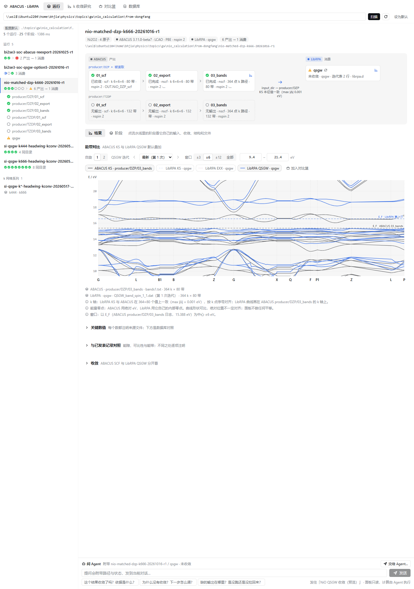

# dsh-abacusflow

An **ABACUS + LibRPA research workbench** for [DeepSeek Harness (DSH)](https://github.com/deepseek-ai):
a panel that shows DFT → GW / QSGW calculations as producer → consumer pipelines and opens on
their results, plus `abacus_*` / `librpa_*` agent tools that read exactly the same data.



## What it does

- **Pipeline first.** Scanned folders become runs of stages: ABACUS producer branches
  (`01_scf → 02_export → 03_bands`) feeding LibRPA consumers. The link between them is drawn
  from evidence (`librpa.in`'s `input_dir`, the same directory, or a labelled layout guess).
- **Results first.** A run opens on its band overlay — ABACUS KS vs LibRPA QSGW — with QSGW
  iteration and spin controls. Curves share an axis only when that is provably valid
  (identical k paths, or LibRPA's KS eigenvalues reproducing ABACUS point by point); nothing is
  shifted, interpolated or resampled.
- **Honest states.** Six stage states (converged/finished, not converged, running, no output,
  error, evidence mismatch), each with its own glyph shape and label.
- **Provenance everywhere.** Every gap names its producer and source file; none is derived from
  band indices.
- **Comparisons.** In-run ABACUS vs LibRPA, k-mesh convergence studies across runs, and the
  published [LibRPA-database](https://github.com/AroundPeking/LibRPA-database) records — gaps
  side by side with their sources, every field that makes the two (in)comparable, and band
  curves on one axis only when the k paths are provably identical.
- **Diagnosis.** Every stage has a 诊断 tab: the decisive log lines quoted with file and line
  (including a Slurm cancel in `librpa.err`), what the input asked for against what the output
  holds, absent files, and a one-line verdict — also available to the agent as `abacus_diagnose`.
- **Agent handoff.** The panel is read-only; it composes context-rich messages and posts them
  into the current DSH conversation, the way DSH's own composer does. The agent does the computing.

Design of record: [UI.md](UI.md). Plugin details (in Chinese): [packages/dsh-abacusflow/README.md](packages/dsh-abacusflow/README.md).

## Install

Requires DSH 0.2 and Node ≥ 20. The plugin has **no npm dependencies** (host: `node:` builtins;
client: the `react` DSH provides), so there is no install or build step.

```bash
# from DSH: plugin_manager install_bundle  target = <clone>/packages/dsh-abacusflow
# or:
dsh plugin --profile <name> add <clone>/packages/dsh-abacusflow
```

Restart DSH fully afterwards — the client bundle is not hot-reloaded.

## Configure

Machine-specific settings are kept out of git. Copy the example and fill in your paths:

```bash
cp packages/dsh-abacusflow/local-config.example.json packages/dsh-abacusflow/local-config.json
```

| Key | Meaning |
|---|---|
| `defaultScanRoot` | folder the panel scans on first open |
| `libraryRoot` | metadata-only index of the LibRPA-database (optional) |
| `remoteHost`, `remoteLocalRoot` | SSH alias and landing folder for the remote-pull tools (optional) |
| `dev.*` | sample-data locations for the real-data tests and preview scripts (optional) |

A key set in `cordis.patch.yml` wins over the local file. Everything is optional: without it the
panel starts blank and the database comparison says it is not configured.

## Develop

```bash
cd packages/dsh-abacusflow
node scripts/verify.mjs           # manifest, imports, client parse, patch, locale, icon
node --test test/*.test.mjs       # parsers, panel logic, routes (real-data tests skip without dev paths)
node scripts/screenshots.mjs      # real panel in headless Chrome → ../../screenshots
node scripts/check-ask-box.mjs    # ask box, main page and dock, against a stand-in DSH session service
node scripts/check-library-figures.mjs   # database figures decode per quantity tab; audits open
```

The preview and screenshot scripts render the real `lib/client.js` against the real host routes.
They need Chrome (`CHROME_PATH`) and React 19's CommonJS builds (`ABACUSFLOW_REACT_DIR`, or found in a
local pnpm store); nothing is downloaded.

## Notes

- The screenshots show real NiO, Bi2Se3 and Si calculations.
- The LibRPA-database is a separate project; it is not included here.

## License

[MIT](LICENSE)
